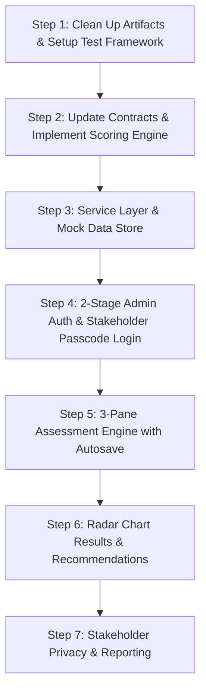

# UCCMM Assessment Toolkit — Master Implementation Plan & Repository Assessment

> **Document Version**: 2.0.0  
> **Status**: Approved Implementation Plan  
> **Based on**: Newly Added Specifications in `docs/` (`UCCMM Assessment Scoring Specification.md` & `UCCMM Assessment Toolkit — Master Development Prompt.md`)

---

## 1. Executive Summary & Repository State Assessment

An audit of the current repository was performed against the master requirements and newly added documentation in `docs/`.

### 1.1 Current Architecture & Configuration
- **Monorepo Structure**: Configured using **pnpm workspaces** with two packages:
  - `apps/web`: Vite 7 + React 19 + TypeScript + Tailwind CSS 4 + `vite-plugin-pwa`.
  - `packages/contracts`: Zod schemas and TypeScript domain contracts shared with `apps/web`.
- **Package Management & Tooling**:
  - `pnpm@11.25.0` package manager.
  - Workspace scripts configured: `dev`, `build`, `lint`, `test`, `typecheck`.
  - TypeScript strict mode enabled across packages.
  - Vitest configured for unit tests (currently passes with 0 test files).
  - ESLint flat config (`eslint.config.js`) configured and passing.
- **PWA Configuration**: `vite-plugin-pwa` configured in `apps/web/vite.config.ts` with auto-update, manifest definition, and Workbox caching.
- **Local Persistence**: `idb` (IndexedDB) installed in `apps/web` with an initial draft store in `apps/web/src/lib/storage.ts`.

### 1.2 Identified Conflicts, Code Artifacts & Technical Debt
1. **Residual Next.js Server Artifacts**:
   - The directory `apps/web/app/api/auth/` contains server route files (`refresh/route.ts`, `sign-in/route.ts`, `sign-out/route.ts`) importing `next/server`.
   - *Conflict*: The project is strictly a client-side Vite SPA Progressive Web Application. Next.js is explicitly disallowed per the master specification. These residual routes are uncompiled, unused, and cause architectural confusion. They must be removed or refactored into pure client-side auth services.
2. **Missing Test Suites**:
   - While Vitest is configured in both `packages/contracts` and `apps/web`, there are currently zero test suites (`.test.ts` / `.spec.ts`).
3. **Hardcoded UI & Fake Delays**:
   - Authentication in `SignInPage.tsx` relies on a dummy `setTimeout(..., 250)` without persisting session state or distinguishing between Admin and Stakeholder session models.
   - Dashboard, results, and recommendation views display static hardcoded arrays (`scores = [80, 39, 19, 58, 98, 11]`).

---

## 2. Gap Analysis: Current Code vs Newly-Added Docs in `docs/`

The newly added documentation introduces explicit academic and business requirements that diverge significantly from the existing placeholder implementation:

| Requirement Category | Master Docs Specification (`docs/`) | Current Repository State | Critical Gap / Action Required |
| :--- | :--- | :--- | :--- |
| **Maturity Levels** | **5 Levels**: Initial, Developing, Defined, Managed, Optimising | 4 Levels defined: Initial, Developing, Defined, Optimising | **High**: Add `Managed` level; update classification rules in `@assessment/contracts` and web UI. |
| **Questions & Dimensions** | **6 Dimensions**, each with **5 core questions** (30 core questions total); 5 response options (values 1–5). | 6 dimensions with 4 questions each (24 questions total); hardcoded prompts. | **High**: Expand template to 30 core questions (5 per dimension); externalise data configuration; support future dynamic questions. |
| **Scoring Formula (Dimension)** | $D_j = \frac{\sum_{i=1}^{n_j} r_{ij}}{5n_j} \times 100$ | Arbitrary normalization or static mock percentages. | **Critical**: Implement exact mathematical formula in domain scoring module with unit test verification. |
| **Scoring Formula (Overall)** | $M = \sum_{j=1}^{6} w_j D_j$ with configurable weights summing to 1.0 (100%). | Unweighted average calculation (`score / 5.0`). | **Critical**: Implement weighted overall score calculation; validate weight summation ($= 1.0$). |
| **Assessment Versioning & Immutability** | Completed assessments must store immutable snapshots of responses, values, weights, scores, and version date. | No snapshotting or versioning model exists. | **High**: Define immutable `AssessmentRecord` schema preserving historical integrity. |
| **Admin Onboarding Journey** | **2-Stage Registration**: Stage 1 = Org Profile (Name, Sector, Size, ERP Platform, Implementation Stage); Stage 2 = Admin Personal Details. | 1-step basic form (Name, Email, Password). | **Medium**: Implement two-stage registration wizard with React Hook Form and Zod validation. |
| **Stakeholder Authentication** | Invited only; sign in using **Email + Passcode**; no signup option; admin manages default passcodes. | Single sign-in form with email/password; mock navigation toggle. | **High**: Implement Stakeholder passcode authentication; prevent Stakeholder self-registration; create passcode management in Admin settings. |
| **Stakeholder Portal Isolation** | Stakeholder must **never** see admin navigation, recommendations, organisation analytics, or stakeholder management. | `AppShell.tsx` provides Stakeholders access to `/recommendations` and common dashboard. | **Critical**: Create dedicated, simplified Stakeholder portal layout completely separate from Admin navigation. |
| **Assessment UI Layout** | **3-Pane Desktop Layout**: Left = Dimensions with status; Centre = Question + 5 options; Right = Question navigation/progress grid. | 2-column layout (Dimension list + Question card); no question progress grid. | **Medium**: Build 3-pane layout per Figma specification, with responsive adaptation for tablet/mobile. |
| **Assessment Review Workflow** | Formal review screen before submission listing answered and unanswered questions with quick return navigation. | Assessment submits directly from the final question card without review. | **Medium**: Add pre-submission Review stage with validation check preventing submission if required items are unanswered. |
| **Data Visualisation** | Dimension scores displayed using a **Radar Chart** representing all 6 dimensions. | Progress bars and circular progress rings only. | **Medium**: Implement or integrate SVG/canvas-based Radar (spider) chart for multidimensional maturity. |
| **Anonymisation & Privacy** | Admin tracks completion counts (invited, in progress, completed) but **cannot** see individual stakeholder answers or scores. | Table lists mock stakeholder names alongside statuses with no privacy abstraction. | **Critical**: Structurally decouple respondent identity from response store in data schemas and mock/backend queries. |
| **Recommendations Engine** | Recommendations triggered for scores between **10% and 80%**; associated with assessment version/date; historical filtering. | Static 3-item hardcoded array. | **Medium**: Build rule-based recommendation generator linked to dimension scores; support date-based historical filtering. |
| **Report Generation** | Download Report CTA disabled initially; enabled only after assessment completion; exports org summary, radar chart, recommendations. | Static button on Reports page with no dynamic assessment binding. | **Low/Medium**: Implement dynamic report view and client-side PDF/print generation. |

---

## 3. Phased Implementation Roadmap

### Milestone 1: Project Foundation & Cleanup
- [x] Monorepo workspace setup (`pnpm`, `apps/web`, `packages/contracts`).
- [x] Vite + React 19 + Tailwind CSS 4 foundation.
- [ ] **Remove Next.js server remnants**: Delete `apps/web/app/` and unreferenced `apps/web/lib/auth.ts`.
- [ ] **Setup Vitest unit test harnesses** in both packages (`packages/contracts` and `apps/web`).
- [ ] Verify `pnpm lint`, `pnpm typecheck`, and `pnpm test` run clean in CI/local workflow.

### Milestone 2: Contracts, Domain Schemas & Scoring Engine
- [ ] Update `@assessment/contracts`:
  - [ ] Define 5 maturity levels: `'Initial' | 'Developing' | 'Defined' | 'Managed' | 'Optimising'`.
  - [ ] Define 2-stage Admin Registration schema (Organisation Profile + Admin Personal Details).
  - [ ] Define Stakeholder Invite & Passcode Login schemas.
  - [ ] Define 30 core assessment questions across the 6 UCCMM dimensions.
  - [ ] Define response option schema with weights ($1 \dots 5$).
  - [ ] Define immutable `AssessmentRecord`, `DimensionScore`, and `OverallMaturity` schemas.
- [ ] Implement mathematical scoring engine in `@assessment/contracts` or dedicated scoring module:
  - [ ] Dimension score function: $D_j = \frac{\sum r_{ij}}{5n_j} \times 100$.
  - [ ] Overall score function: $M = \sum w_j D_j$.
  - [ ] Weight validator ($\sum w_j = 1.0$).
  - [ ] Maturity classification rule engine mapping percentage scores to the 5 levels.
- [ ] Add comprehensive unit tests covering standard scoring, edge cases (all min, all max), rounding, and validation.

### Milestone 3: Mock Data Service Layer & Offline Persistence
- [ ] Create domain service layer in `apps/web/src/services/` to decouple UI from backend:
  - [ ] `AuthService`: Handles Admin authentication, 2-stage registration, and Stakeholder passcode sign-in.
  - [ ] `AssessmentService`: Handles template retrieval, draft persistence, submission, and scoring.
  - [ ] `StakeholderService`: Handles stakeholder invitation, passcode management, and participation status.
  - [ ] `ReportService`: Handles report compilation and historical assessment retrieval.
- [ ] Enhance IndexedDB persistence (`src/lib/storage.ts`):
  - [ ] Multi-draft support (distinguish between Admin drafts and Stakeholder drafts).
  - [ ] Store assessment metadata, responses, timestamp, and active question index.
  - [ ] Auto-save hook with debounce and online/offline status handling.

### Milestone 4: Design System & Application Shells
- [ ] Align Tailwind tokens and CSS variables with Figma design system:
  - [ ] Typography: Inter for body/UI, Anton for brand identity.
  - [ ] Exact color palette: primary dark (`#010a14`), primary brand blue (`#077bf8`), backgrounds (`#f3f6f5`, `#ffffff`), status tints.
  - [ ] Button states (default, hover, focus, active, disabled).
  - [ ] Form input states (default, focus, filled, valid, error, disabled).
- [ ] Build dual portal shells:
  - [ ] **Admin Shell**: Top navigation (Dashboard, Stakeholders, Recommendations), user dropdown, organization badge.
  - [ ] **Stakeholder Shell**: Clean, distraction-free header without admin links, prominent user status, logout action.
- [ ] Build reusable UI atoms and molecules:
  - [ ] `StatCard` (with delta/detail pills).
  - [ ] `StatusBadge` (Not Started, In Progress, Completed/Submitted).
  - [ ] `EmptyState` component (title, description, dynamic CTA).
  - [ ] Accessible modal dialog for adding stakeholders.

### Milestone 5: Authentication & Onboarding Flows
- [ ] **User Type Selection Screen**:
  - [ ] Figma-faithful toggle between Admin / Organisation and Stakeholder.
- [ ] **Admin Authentication**:
  - [ ] Login screen with Email, Password, Remember Me, Forgot Password, and "Set up your organisation" CTA.
  - [ ] 2-Stage Organisation Registration Wizard:
    - [ ] Stage 1: Organisation Name, Sector, Employee Count, ERP Platform, Implementation Stage.
    - [ ] Stage 2: Admin Email, Password, Password Confirmation with real-time validation.
- [ ] **Stakeholder Authentication**:
  - [ ] Simplified Email + Passcode login.
  - [ ] Explicitly disallow self-registration.

### Milestone 6: Assessment Engine & 3-Pane Interface
- [ ] **Assessment Introduction Page**:
  - [ ] Explains dimensions, 30 questions, scoring method, autosave notice, and Start CTA.
- [ ] **3-Pane Assessment Layout**:
  - [ ] **Left Pane**: Dimension list with status badges (Not Started, In Progress, Completed).
  - [ ] **Centre Pane**: Current dimension title, description, question prompt, and 5 selectable weighted options.
  - [ ] **Right Pane**: Question navigator grid showing question numbers with answered/unanswered states.
- [ ] **Non-Linear Navigation & Autosave**:
  - [ ] Allow users to jump between questions and dimensions freely.
  - [ ] Real-time autosave to IndexedDB on every selection.
  - [ ] Restore user's exact state on page reload or re-login.
- [ ] **Assessment Review Screen**:
  - [ ] Overview of all 30 questions grouped by dimension.
  - [ ] Visual indicator of answered vs skipped questions.
  - [ ] Disabled "Submit Assessment" CTA if required questions remain incomplete.
  - [ ] Confirmation prompt upon final submission.

### Milestone 7: Scoring, Results, Radar Chart, Recommendations & Reports
- [ ] **Results Screen**:
  - [ ] Prominently display Overall Maturity Score ($M$) and Maturity Level (1 of 5).
  - [ ] Dimension score breakdown list.
  - [ ] **Radar Chart**: Multidimensional 6-axis SVG/canvas chart illustrating maturity balance.
- [ ] **Admin Historical Assessment Timeline**:
  - [ ] Date selector (e.g., "7 September 2026", "15 October 2026").
  - [ ] Viewing past assessments loads immutable historical snapshot.
- [ ] **Recommendations Engine**:
  - [ ] Filter dimensions scoring between 10% and 80%.
  - [ ] Generate actionable improvement advice, rationale, and next steps towards "Optimising".
  - [ ] Historical recommendation filtering by assessment date.
- [ ] **Report Generation**:
  - [ ] Ensure "Download Report" CTA on dashboard is disabled when no assessment exists.
  - [ ] Comprehensive report view formatted for print/PDF export.

### Milestone 8: Stakeholder Management, Anonymisation & Production Polish
- [ ] **Stakeholder Management Interface**:
  - [ ] Participation metrics: Total Invited, In Progress, Completed, Not Started.
  - [ ] "Add Stakeholder" modal form (Name, Email, Department, Job Role).
  - [ ] Passcode management and invitation simulation.
  - [ ] **Privacy Verification**: Ensure stakeholder individual answers are cryptographically or architecturally detached from admin views.
- [ ] **End-to-End Testing & Polish**:
  - [ ] Vitest test coverage for scoring math, storage, and contracts.
  - [ ] Responsive testing across desktop, tablet, and mobile breakpoints.
  - [ ] Accessibility audit (focus indicators, keyboard navigation, aria-labels).
  - [ ] Production build and service worker offline verification.

---

## 4. Immediate Priority Backlog

1. **Clean Codebase**: Remove `apps/web/app/` Next.js route fragments.
2. **Upgrade Contracts**: Update `AssessmentQuestion`, `AssessmentDimension`, add `Managed` maturity level, implement the exact formulas $D_j$ and $M$ in `@assessment/contracts`.
3. **Write Unit Tests**: Test the scoring engine thoroughly with Vitest.
4. **Implement Service Layer**: Abstract data operations so the UI works seamlessly with mock data or Supabase.
