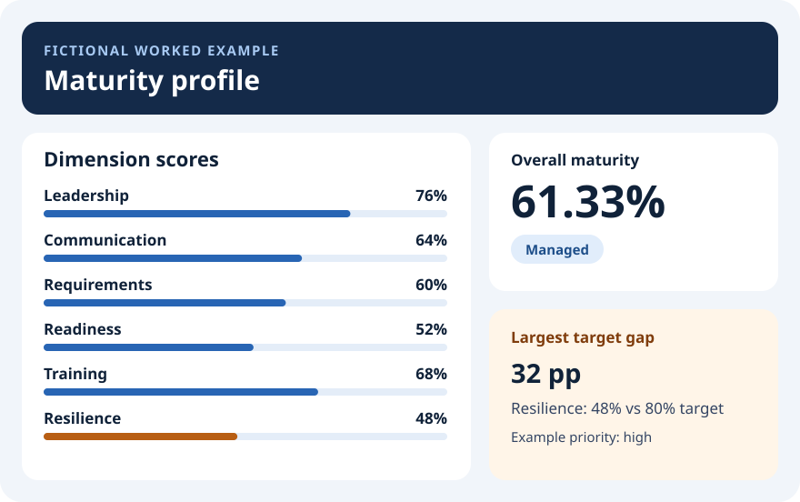

# UC-CMMM Assessment Toolkit

**A decision-support tool for managing the people side of an ERP rollout.** The User-Centred Change Management Maturity Model (UC-CMMM) helps IT leaders in Nigerian organisations assess current practices, identify gaps, and decide what to improve first. It does not run or integrate with an ERP system.

[Open the live toolkit](https://uccmmm-assessment-toolkit.vercel.app) · [Set up locally](SETUP.md) · [Rehearse the presentation](PRESENTATION.md)



## What it does

- **Assess maturity.** Rate 30 criteria across six dimensions: leadership, communication, requirements, readiness, training, and resilience. Optional evidence notes do not affect scores.
- **Plan improvements.** Admins set targets, see the largest shortfalls first, and get a rule-based improvement roadmap. Each submitted baseline keeps its own target snapshot. Admins can print a report or save it as PDF.
- **Track participation without seeing individual results.** Invited stakeholders complete their own assessment and see their own results. Admins can see names and participation status, not stakeholder answers, notes, or scores.
- **Resume a draft after an interruption.** The production PWA saves drafts locally. Users can opt in to offline restart recovery on a private browser profile for seven days. Sync and submission require online session verification. See [offline behaviour](MATURITY-PLANNING.md#offline-behaviour).

### Worked example

The instrument uses five ratings from 1 to 5 per dimension. Each dimension is scored as the sum of its ratings divided by 25, expressed as a percentage. The overall score is the equally weighted mean of the six dimension scores. The fictional example above scores **61.33% (Managed)**; its **48%** resilience score is **32 percentage points** below an illustrative **80%** target. Targets do not change the maturity score or band. See [scoring and gap analysis](MATURITY-PLANNING.md#scoring-and-gap-analysis) for the exact bands and provisional priority rules.

## Run locally

Use Node.js 24 and the pnpm version pinned in [`package.json`](package.json). From the repository root:

```sh
pnpm install --frozen-lockfile
pnpm dev
```

Open [localhost:5173](http://localhost:5173). Without Supabase settings, the development server runs in **demo mode**: choose Admin or Stakeholder and use a test email and a password of at least eight characters. Data stays in this browser and no invitation emails are sent. To use real accounts, follow the [Supabase setup](SETUP.md#6-connect-a-supabase-project).

## Repository map

| Path | What it contains |
| --- | --- |
| [`apps/web`](apps/web) | React/Vite PWA, role-based UI, and IndexedDB draft storage |
| [`packages/contracts`](packages/contracts) | Questionnaire, domain schemas, scoring, and recommendation rules |
| [`supabase`](supabase) | Postgres migrations, access policies, invitation functions, and SQL regression checks |
| [`vercel.json`](vercel.json) | Static hosting configuration and SPA routes |

### Verify a change

```sh
pnpm typecheck
pnpm lint
pnpm -r test --maxWorkers=1
pnpm --filter @assessment/web demo:test
pnpm build
```

The GitHub Actions workflow runs these checks without hosted credentials. For database and live deployment checks, see [Supabase deployment](supabase/README.md) and the [presentation checklist](PRESENTATION.md#release-sign-off).

## Project status

This is the software artefact for Omoyayi Ajibola’s Master’s project at MIVA Open University. The recommendation content and priority thresholds are provisional; software tests are not a substitute for Delphi review, a practitioner case study, or user acceptance testing. See [maturity planning and validation notes](MATURITY-PLANNING.md#verification-and-remaining-work) for what still needs validation.

Software license: [Apache 2.0](LICENSE).
